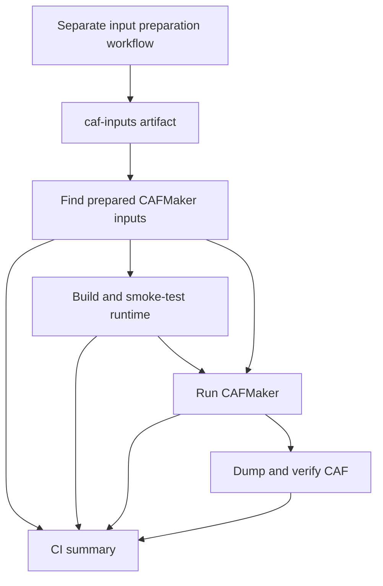

# Developer Guide: Local Regression Tests and CI

This guide documents the CAFMaker CI/reference workflow, the purpose of every
maintained file involved in it, and the full developer process for testing,
debugging and submitting changes. The file inventory covers that workflow and
its build/configuration dependencies, not the internals of every detector
algorithm in the repository.

**Generate output first, inspect the difference, and update the reference only
when the difference is intentional and justified.** Missing inputs, failed
builds, broken environments and unexpected physics changes are not reasons to
replace a reference.

Commands assume the repository root, the directory containing
[CMakeLists.txt](CMakeLists.txt), unless stated otherwise. General CAFMaker build
and analysis documentation is in [README.md](README.md).

## Contents

- [Quick Start](#quick-start)
- [What Is Tested](#what-is-tested)
- [File-by-File Reference](#file-by-file-reference)
- [Requirements and Environment](#requirements-and-environment)
- [Local Command Reference](#local-command-reference)
- [Filesystem and Cleanup](#filesystem-and-cleanup)
- [Full Developer Workflow](#full-developer-workflow)
- [Retaining Outputs for Debugging](#retaining-outputs-for-debugging)
- [GitHub Actions Architecture](#github-actions-architecture)
- [Reading the Summary](#reading-the-summary)
- [Forks, Drafts and Labels](#forks-drafts-and-labels)
- [Maintainer Procedures](#maintainer-procedures)
- [Troubleshooting](#troubleshooting)
- [Known Limits](#known-limits)
- [Review Checklist](#review-checklist)

## Quick Start

Check the checkout against the existing reference:

```bash
./scripts/caf-regression --check
```

Use an existing or new input cache outside `/tmp`:

```bash
./scripts/caf-regression --check --cache-dir "$HOME/ndcaf-ci-inputs"
```

Regenerate a reference after reviewing an intentional output change:

```bash
./scripts/caf-regression --update-reference --cache-dir "$HOME/ndcaf-ci-inputs"
git diff -- test/references/
```

Run the fast, download-free orchestration/reporting tests:

```bash
python3 test/scripts/test_caf_regression.py -v
```

The full regression needs Apptainer, CVMFS and real inputs. The fast Python tests
do not. Neither command commits or pushes changes.

## What Is Tested

The full regression performs these operations:

1. Build and install CAFMaker in the selected SL7 environment using `prof` and
	 CMake Release. Check that the installed `makeCAF` is on `PATH` and runs `--help`.
2. Run the installed executable with [test/fickle.fcl](test/fickle.fcl) and `-n 1`.
3. Dump sampled readable ROOT content to JSON and compare it textually with the
	 checked-out reference using `diff -u`.

The expected ROOT filename is `MiniProdN5p1_NDComplex_FHC.0000965.CAF.root`.
The committed baseline is
[test/references/MiniProdN5p1_NDComplex_FHC.0000965.CAF.root.json](test/references/MiniProdN5p1_NDComplex_FHC.0000965.CAF.root.json).

The comparison detects changes to sampled values, readable branch names,
reported tree structure, recorded decoder errors and JSON formatting. It is
not a byte-for-byte ROOT comparison or a complete physics validation.

| Test | Purpose | Real physics inputs? |
| --- | --- | --- |
| Full CAF regression | Detect changes in generated CAF output | Yes |
| Runner/summary unit tests | Check orchestration, cleanup, replacement and reporting | No |

Passing mocked tests does not prove that CAFMaker processes a particular dataset.
Passing the sampled regression does not establish correctness for every event
or detector configuration.

## File-by-File Reference

### Shared Runner and Environment

#### [scripts/caf-regression](scripts/caf-regression)

The executable Bash entry point used locally and by CI. It owns option parsing,
prerequisite checks, input-cache preparation, temporary workspaces, container
execution, comparison and safe reference replacement.

| Function | Responsibility |
| --- | --- |
| `usage` | Display supported command forms without downloads/builds |
| `die` | Print a runner error and exit non-zero |
| `prepare_inputs` | Download absent inputs, otherwise warn and reuse the directory |
| `container_exec` | Invoke the selected image with isolation and explicit bindings |
| `build` | Configure, compile, install and smoke-test the installed runtime |
| `run` | Bind inputs read-only and execute the regression fixture |
| `verify` | Create a dump environment, write JSON, compare, optionally replace the reference |
| `cleanup` | Remove runner-owned scratch and unfinished replacement files |

Local modes execute all stages in order. CI calls individual stages and retains
their products in its job workspace. The script does not install Apptainer,
mount CVMFS, manage Git, create persistent container instances or validate caches.

The wrapper uses `set -euo pipefail`. The inner CAFMaker shells do not enable
Bash errexit because normal UPS setup constructs can return non-zero. Build,
install and executable failures are checked explicitly. The Python dump shell
does use errexit and does not source UPS.

#### [test/regression-environment.conf](test/regression-environment.conf)

The shared shell-readable selections. It is sourced as shell code, not parsed
as inert data: keep it to reviewed settings and never put credentials in it.

| Setting | Purpose |
| --- | --- |
| `CAF_IMAGE` | CVMFS image tag for build and CAFMaker execution |
| `PYTHON_IMAGE` | CVMFS image tag for ROOT-to-JSON dumping |
| `CAF_DEPS_SETUP` | Host-visible DUNE setup path checked during preflight |
| `CAF_INPUT_URL` | Public HTTPS directory for a fresh local download |
| `CAF_FILENAME` | ROOT filename and basis of the JSON filename |

`CAF_DEPS_SETUP` is a preflight check, not a general relocation mechanism:
[ndcaf_setup_deps.sh](ndcaf_setup_deps.sh) has its own setup path too.
Changing `CAF_FILENAME` also requires aligning FCL output and workflow artifact
paths. The input-preparation workflows declare their own URLs; changing this
configuration alone does not change those downloaders.

### Fixture and Expected Output

#### [test/fickle.fcl](test/fickle.fcl)

The regression fixture includes the standard CAFMaker configuration, then sets
exact MiniProd input/output paths. It selects twenty GENIE GHEP files, one
SPINE/LAr HDF5 file, one TMS ROOT file and one edep-sim spill ROOT file.

Inputs start with `inputs/` and output starts with `outputs/`. They are relative
to the process working directory, made `/work` inside the runner's container.
The one-event limit comes from the runner's `-n 1`, not from the FCL itself.

For the legacy TMS fixture it explicitly selects:

```text
nd_cafmaker.CAFMakerSettings.TMSRecoTreeSuffix: ""
```

That uses `Reco_Tree` and `Truth_Info` rather than newer defaults such as
`Reco_Tree_C3D` and `Truth_Info_C3D`. Input schema, source revision and accepted
configuration settings must agree. A file can exist but lack the required tree.
Changing fixture settings or input paths changes the regression experiment.

#### [test/references/MiniProdN5p1_NDComplex_FHC.0000965.CAF.root.json](test/references/MiniProdN5p1_NDComplex_FHC.0000965.CAF.root.json)

The committed expected JSON, not an input cache. Local checks use the reference
in the working tree, so uncommitted edits matter. CI uses the reference in its
checkout, which ordinarily includes the PR's merge with the target branch.

The document contains `trees` and `unreadable_branches`. Readable leaves hold
sampled values; unreadable leaves hold decoder error descriptions, not their
physics content. An empty branch table may reflect unreadability, not an empty
original ROOT tree. The standard workflow does not compare unreadable payloads.

Update through the runner after understanding a difference. Hand-editing expected
numbers is not the standard workflow and can hide an error.

### Dumping and Reporting

#### [test/scripts/dumper.py](test/scripts/dumper.py)

Converts ROOT tree leaves to JSON with `uproot`, `awkward` and `numpy`.
`dump_root_file` walks trees/leaves, reads the selected entries and writes JSON.
`json_safe` recursively normalises values.

Conversion rules include:

- Bytes become UTF-8 strings, with replacement for invalid sequences.
- NumPy values become ordinary Python values.
- NaN and infinities become `null`.
- A single sampled entry is stored without an extra outer entry-list wrapper.
- Individual decoding failures are recorded under `unreadable_branches`; they
	do not themselves fail the dump command.

| Option | Meaning |
| --- | --- |
| Positional input | ROOT file to inspect |
| `-o`, `--output` | Output JSON; default is the input path followed by `.json` |
| `-n`, `--entries` | Entries per tree; default `1`, or `0` for all |
| `--vector-entries` | Retained elements in each vector/list, recursively |
| `--fingerprint-unreadable` | Attempt per-entry SHA-1 fingerprints of unreadable raw branch records |

The standard runner uses one entry per tree and `--vector-entries 5`. Nested
vectors are also truncated, not just the outer vector. Fingerprinting is an
investigation option, not enabled by default. Altering these options changes the
baseline contract. The printed "Wrote ..." message is logging; redirecting stdout
does not replace `--output` because the JSON is written separately.

#### [test/scripts/ci_summary.py](test/scripts/ci_summary.py)

A standard-library-only report generator, not a comparison authority or physics
runner. Its `regression` command reads two JSON documents and their raw diff,
then writes Markdown. Its `summary` command combines job results, step metadata
and the regression preview, then appends to `GITHUB_STEP_SUMMARY`.

| Function | Responsibility |
| --- | --- |
| `changes` | Walk JSON objects/arrays and classify added, removed and changed values |
| `cell`, `value_cell` | Escape and shorten display values |
| `raw_diff` | Render an escaped, bounded collapsible raw-diff preview |
| `render_regression` | Count differences and build the field comparison |
| `render_summary` | Classify run outcomes and report stages, failures and links |

Field paths use JSON Pointer: `/` inside a key becomes `~1`, `~` becomes `~0`,
and array indices start at zero. The table shows at most fifty rows; cells are
shortened after 160 characters. The raw preview is bounded to 200 lines and
40,000 characters. The diagnostic artifact keeps the complete diff and JSON.
Counts describe JSON-path differences, not a count of changed physical events.

The textual comparison remains authoritative. If formatting differs but parsed
JSON values match, the report explains that distinction. Rendering a report
does not turn a failed comparison into success.

#### [test/scripts/test_caf_regression.py](test/scripts/test_caf_regression.py)

The Python `unittest` suite for runner control flow and summary rendering. It
creates miniature temporary repositories/caches and fake external executables,
including `apptainer` and `wget`. Those write tiny placeholder outputs rather
than download data or process physics.

Coverage includes cache reuse, failed downloads, paths with spaces, untouched
repository products, failed stages, atomic replacement, preserved permissions,
interruptions, retained stage artifacts and explicit comparison outputs. It also
checks the ANSI summary banner's placement and successful-run silence.

Summary coverage includes passing comparisons, real mismatches, upstream/dump
failures, cancellations, skips, preparation-only runs, added/removed fields,
escaping, truncation and artifact/reporting failures.

CI invokes it before compilation. It needs host Python and standard Unix tools,
but no CVMFS, containers, physics inputs or PyPI packages. Deleting it without
removing the CI invocation would break the build job.

### GitHub Workflow Files

#### [.github/workflows/ci.yml](.github/workflows/ci.yml)

The main PR/manual orchestrator: resolve input artifacts, build/install/package
runtime, run CAFMaker on another runner, dump/verify output, write the report.
It owns draft guards, concurrency, artifact transfers and failure annotations.
All real build/run/verify operations call the shared runner.

It requests `contents: read` and `actions: read`. Fork PRs into upstream do not
require contributor secrets or a personal access token. The small YAML anchor
names the resolver's failure-link step; other jobs currently have explicit
failure-link steps. These help navigation, not error suppression.

#### [.github/workflows/prepare-ci-inputs.yml](.github/workflows/prepare-ci-inputs.yml)

The independent input refresh workflow. It is scheduled on the default branch
for 03:17 UTC daily and can be dispatched manually. GitHub schedules can be
delayed; the job has a sixty-minute timeout.

It checks the HTTPS directory with recursive `wget --spider`, downloads the
directory tree and uploads `caf-inputs` with two-day retention. URL directory
depth determines how paths are stripped into `inputs/`; index pages are rejected
and an empty download fails. Its concurrency does not cancel earlier preparation.

It neither builds CAFMaker nor creates a reference. Bootstrap it before PR CI
needs default-branch inputs, and keep scheduled refresh functioning.

#### [.github/workflows/reference-label.yml](.github/workflows/reference-label.yml)

A metadata-only workflow using `pull_request_target`. On PR open, commit updates,
reopening or editing, it lists changed files and checks whether the current or
previous filename starts with `test/references/`. Additions, deletions and renames
can therefore trigger `changes-reference` as well as modified content.

It creates the label if absent and adds it to the PR. It does not validate physics,
approve changes or remove an old label when later commits eliminate the changes.
The label workflow does not inherit the main workflow's draft guards.

It has write permissions solely for metadata handling and never checks out or
executes PR code. Keep that trust boundary intact. The initial PR introducing
this workflow cannot rely on its new privileged workflow running: GitHub uses
the trusted target-side workflow, which must already exist for the event.

### Supporting Build and Configuration Files

#### [ndcaf_setup_deps.sh](ndcaf_setup_deps.sh)

Sets up the UPS environment before CMake: compiler/library products, dependency
versions/qualifiers, library paths and CMake search paths. It accepts `prof` or
`debug`. Products include CMake, edep-sim, GENIE, duneanaobj, HDF5 and fhiclcpp.
Most selections are explicit; `curl` and `pycurl` remain unversioned.

Changing it can change build/runtime behaviour or the CAF schema even without
changing a branch filler. The installed runtime includes a copy but still needs
CVMFS; it does not bundle all third-party dependencies.

#### [ndcaf_setup.sh](ndcaf_setup.sh)

The installed-runtime entry point, which must be sourced. It sources dependency
setup and adds the adjacent `bin/`, `lib/` and `cfg/` locations to `PATH`,
`LD_LIBRARY_PATH` and `FHICL_FILE_PATH`. It discovers paths from its own location,
allowing the installed tree to be extracted into another job's workspace.
Host sourcing alone does not replace the required container environment.

#### [CMakeLists.txt](CMakeLists.txt)

The top-level build definition selects C++17, warnings, Debug sanitiser flags,
external dependencies, optional features and installed runtime paths. It includes
[cmake/FindUPSPackage.cmake](cmake/FindUPSPackage.cmake), which bridges UPS
dependencies into CMake, and delegates compilation to
[src/CMakeLists.txt](src/CMakeLists.txt).

Installed runtime paths include the adjacent local library and external
dependency locations. The regression explicitly installs into its work directory,
not `/usr/local`.

#### [src/CMakeLists.txt](src/CMakeLists.txt)

Lists sources for `libND_CAFMaker.so`, builds/links `makeCAF` and installs targets.
New implementation source files normally need inclusion in the appropriate
target here. The installed executable location is `install/bin/makeCAF` under
the regression work directory; do not assume an arbitrary uninstalled build
binary has the same runtime configuration.

#### [cfg/NDCAFMaker.fcl](cfg/NDCAFMaker.fcl)

The standard configuration included by the fixture. Changes to defaults affect
the regression unless explicitly overridden there. CMake installs these FCL
files, and runtime setup exposes them through `FHICL_FILE_PATH`.

#### [cfg/ndcafmakerjob.fcl](cfg/ndcafmakerjob.fcl) and [cfg/pandora.fcl](cfg/pandora.fcl)

The first is a general example job configuration, the second Pandora-related
configuration. Both are installed with the other FCL files. Neither replaces
the fixture's exact input filenames.

#### [README.md](README.md) and [local.md](local.md)

The README covers general CAFMaker setup, use and contribution context. This
guide covers CI/reference operations. Update their relevant examples when the
runner or build interface changes.

### Source Map

| File/area | Purpose |
| --- | --- |
| [src/makeCAF.C](src/makeCAF.C) | Executable entry point and processing orchestration |
| [src/Params.h](src/Params.h) | Accepted FHiCL settings and defaults |
| [src/CAF.h](src/CAF.h) and [src/CAF.cxx](src/CAF.cxx) | CAF output construction and ROOT writing |
| [src/reco/IRecoBranchFiller.h](src/reco/IRecoBranchFiller.h) | Common reconstruction filler interface |
| [src/reco/MLNDLArRecoBranchFiller.cxx](src/reco/MLNDLArRecoBranchFiller.cxx) | Machine-learning LAr reconstruction conversion |
| [src/reco/TMSRecoBranchFiller.cxx](src/reco/TMSRecoBranchFiller.cxx) | TMS input reading and CAF filling |
| [src/reco/NDLArTMSUniqueMatchRecoFiller.cxx](src/reco/NDLArTMSUniqueMatchRecoFiller.cxx) | LAr/TMS matching |
| [src/truth/FillTruth.cxx](src/truth/FillTruth.cxx) | Truth filling |
| [src/beam/IFBeam.cxx](src/beam/IFBeam.cxx) | Beam information integration |
| [src/util/Logger.cxx](src/util/Logger.cxx) | Logging support |

Other reconstruction fillers support Pandora, MINERvA, SAND and detector
matching; the HDF5 reader supports LAr access. Change algorithms in their owning
modules rather than adding detector-specific workarounds to the CI driver.

## Requirements and Environment

### Host Requirements

- Linux x86-64, Bash, Apptainer and GNU tools such as `diff`, `mktemp`, `cp`,
	`chmod`, `mv` and `rm`.
- `wget` for a new local input download.
- Mounted CVMFS repositories: `dune.opensciencegrid.org`,
	`larsoft.opensciencegrid.org`, `fermilab.opensciencegrid.org`,
	`oasis.opensciencegrid.org` and `singularity.opensciencegrid.org`.
- HTTPS access to the input website, PyPI and its package download hosts.
- Disk space for cache, fresh build/install, ROOT output and dump environment.
- Host Python 3 for the fast tests and standalone report generation. Full
	regression dumping uses container Python instead.

The runner does not install system packages or mount local CVMFS. GitHub Actions
provisions those on its own runners.

Check basic prerequisites without downloading data:

```bash
command -v bash
command -v apptainer
command -v wget
source test/regression-environment.conf
ls -ld "$CAF_IMAGE" "$PYTHON_IMAGE"
test -f "$CAF_DEPS_SETUP"
apptainer exec --cleanenv "$PYTHON_IMAGE" python3 --version
```

The Python version is printed by the runner. These checks do not prove that
every UPS dependency and every input is available.

### Pinning and Isolation

The images use mutable `latest` CVMFS tags: `fermilab/fnal-wn-sl7:latest` for
CAFMaker and `library/python:latest` for dumping. The latter provided Python
3.15.2 when last checked, but the runner reports the runtime version rather than
requiring that exact version. Both container uses have `--cleanenv` and
`--containall` plus explicit mounts; the run stage adds a read-only input mount.
Because the tags move, a later run can use different image contents without a
source change.

This avoids reliance on an arbitrary host Python or already-sourced host UPS
stack, but is not a complete reproducibility guarantee. Dump packages are still
resolved from PyPI each run, some UPS selections are unversioned, and local
cache bytes need not match CI artifact bytes.

## Local Command Reference

| Invocation/option | Behaviour |
| --- | --- |
| No arguments | Same as `--check` |
| `--check` | Full build/run/dump/compare; never replace the reference |
| `--update-reference` | Full run, then replace a differing reference after successful generation/comparison |
| `--cache-dir DIR` | Override cache; a relative path is relative to the invocation directory |
| `--stage build` | Configure/build/install/smoke-test in an explicit work directory |
| `--stage run` | Use an existing runtime and existing cache |
| `--stage verify` | Dump an existing ROOT output and compare; no reference updates |
| `--work-dir DIR` | Caller-owned stage directory; only valid with `--stage` |
| `-h`, `--help` | Usage before downloads or preflight |

Choose one local mode. Stages require `--work-dir` and cannot be combined with
either local mode. Staged execution never calls the input downloader; `run`
fails if the chosen cache is absent.

The repository is discovered from the script's own path, so invocation by
absolute path works from another directory. Quote paths containing spaces.
Host bind paths containing colons or commas are rejected because they conflict
with Apptainer bind syntax.

### Outcomes and Exit Status

| Outcome | Behaviour |
| --- | --- |
| Check matches | Exit `0`, reference unchanged |
| Check differs | Exit `1`, diff printed, reference unchanged |
| Update succeeds | Exit `0`, print diff/replacement path |
| Update already matches | Exit `0`, no replacement |
| Build/run/install/dump error | Non-zero, no reference update |
| Preflight/comparison error | Non-zero, commonly `1`; inspect the message |
| Wrapper handles SIGINT/SIGTERM | Exit `130`/`143` and normal scratch cleanup |

Exit `1` alone does not prove a mismatch. In stage verification CI receives
`comparison=match`, `mismatch` or `error` through `GITHUB_OUTPUT`. The runner
initially records `error` and replaces it only after a usable exact comparison.

With `CI_SUMMARY_URL` present, a failing check prints a bold red ANSI
"REGRESSION FAILED - VIEW THE SUMMARY" banner after the diff. Normal local runs
have no GitHub report URL unless explicitly supplied.

## Filesystem and Cleanup

### Input Cache

Default cache: `/tmp/ndsimreco/CI_files`. A durable `--cache-dir` is useful if your
host cleans `/tmp` or you repeatedly develop on it.

```text
input-cache/
	run-genie/
	run-mlreco/
	run-tms-reco/
	run-spill-build/
```

Point the option at the directory containing these entries, not its parent or
an extra wrapping `inputs/` directory. The layout must match the fixture paths.

If the cache exists, the runner checks only that it is a directory, warns and
assumes it is complete. Even an empty directory is reused. It does not validate
checksums, repair an interrupted download or fetch newer files. A file at the
cache path is rejected.

If absent, it is created and downloaded recursively over HTTPS. Download failure
can leave partial contents that the next run will reuse. Repair that cache or
choose a new, non-existent path deliberately. A new path is often safer than
blindly deleting a directory that contains useful data. Concurrent downloads
into the same cache are not coordinated.

### Local Scratch

```text
runner-owned scratch/
	work/
		build/
		install/
			bin/
			lib/
			cfg/
		inputs/          # cache mounted here during execution inside the container
		outputs/
			MiniProdN5p1_NDComplex_FHC.0000965.CAF.root
			MiniProdN5p1_NDComplex_FHC.0000965.CAF.root.json
			reference.diff
	venv/              # Python environment under /scratch
	image-cache/
```

Scratch is created under host `TMPDIR`, or `/tmp` if unset. It is mounted at
`/scratch`, work at `/work`, and source read-only at `/source`. The input cache
is mounted read-only at `/work/inputs` for the run. Outside that invocation,
the scratch `inputs/` is just a mount point.

Each full local invocation builds/installs afresh, reruns CAFMaker and creates
a new dump virtual environment. There is no compiled-object or persistent
Python-wheel reuse. Repeating a full check skips only the data download if its
cache exists.

The persistent cache survives; an explicit successful reference replacement
survives. Generated local ROOT/JSON/diff files are removed with scratch. Logs
remain in the terminal unless captured. Existing repository `build/`, `install/`
and `outputs/` are not used or deleted by local full modes.

Normal success/failure and handled INT/TERM clean runner-owned scratch and
unfinished sibling replacements. SIGKILL or host failure can leave scratch behind.
Caller-owned stage directories survive all normal runner exits.

Apptainer `exec` is a process, not a persistent instance to delete later. The
shared CVMFS images and pre-existing user caches are not removed.

### Atomic Reference Replacement

After successful generation, update mode compares with the existing reference.
A missing/unreadable reference is a comparison error, not automatic permission
to create a new arbitrary baseline.

For a difference, the runner creates a temporary sibling in the reference
directory, copies the full candidate, applies the old reference permissions,
and renames it over the reference. Readers see the old or completed new file,
not an incomplete copy. Normal cleanup removes unfinished sibling files.

This is not reviewer approval, automatic committing, a concurrent-update lock
or a crash-durability guarantee. Do not update the same checkout's reference
from multiple processes simultaneously.

## Full Developer Workflow

### 1. Set Up the Correct Checkout

For a new fork-based contribution:

```bash
git clone https://github.com/YOUR-USERNAME/ND_CAFMaker.git
cd ND_CAFMaker
git remote add upstream https://github.com/DUNE/ND_CAFMaker.git
git fetch upstream
git remote show upstream
```

Use the target/default branch reported by upstream, not an assumed `main` or
`master`. Create a topic branch from the intended target:

```bash
git switch -c topic/my-change upstream/TARGET-BRANCH
git status --short
git rev-parse HEAD
```

In an existing clone, inspect before adding remotes or branches:

```bash
git remote -v
git status --short
git branch --show-current
```

Do not discard unrelated work. The runner builds filesystem contents, including
uncommitted source, FCL, environment and reference changes, not only `HEAD`.

### 2. Establish the Baseline

Before editing:

```bash
python3 test/scripts/test_caf_regression.py -v
./scripts/caf-regression --check --cache-dir "$HOME/ndcaf-ci-inputs"
```

Record the revision, input source/cache, environment selections and any existing
failure. Investigate a failing baseline before attributing new output to your
code. An old branch baseline does not establish parity with CI's merge checkout.

### 3. Implement a Focused Change

Change the owning source/configuration and add appropriate targeted tests.
Inspect all edits:

```bash
git diff --stat
git diff
```

For orchestration/reporting changes:

```bash
bash -n scripts/caf-regression
python3 test/scripts/test_caf_regression.py -v
```

Use ShellCheck/actionlint when installed; the runner does not provision them.
YAML parsing alone does not validate GitHub expressions or API permissions.

### 4. Run Against the Unchanged Reference

```bash
./scripts/caf-regression --check --cache-dir "$HOME/ndcaf-ci-inputs"
```

A legitimate changed output should produce a diff/non-zero exit. Compare those
fields with the expected effects of your change. Check counts, matching results
and metadata as well as floats. Retain outputs using stage mode when necessary.

If no diff is produced, investigate the build/input/runtime failure first.
If CI differs from local, compare revisions, input bytes, environment and dump
options instead of immediately replacing expected output.

Capture logs without hiding failure behind `tee`:

```bash
set -o pipefail
./scripts/caf-regression --check --cache-dir "$HOME/ndcaf-ci-inputs" 2>&1 | tee caf-regression.log
```

Keep logs and generated outputs out of commits unless deliberately adding a
reviewed fixture. `pipefail` preserves failure when `tee` itself succeeds.

### 5. Update a Justified Reference

Only after understanding the difference:

```bash
./scripts/caf-regression --update-reference --cache-dir "$HOME/ndcaf-ci-inputs"
git diff -- test/references/
```

This runs a new full build/run/dump; it does not reuse the previous check's
cleaned output. Then check the new baseline again:

```bash
./scripts/caf-regression --check --cache-dir "$HOME/ndcaf-ci-inputs"
```

The extra invocation can detect output changing between identical runs. Explain
the physics/software motivation and affected values in the PR, not just "make
CI green". Commit the generated reference if it is part of the intended change.

### 6. Commit and Open a PR

Review, stage only intended files and submit. Example placeholders must be
replaced with actual paths/branch names:

```bash
git diff --check
git add src/PATH-TO-CHANGED-FILE
git add test/references/MiniProdN5p1_NDComplex_FHC.0000965.CAF.root.json
git diff --cached
git commit -m "Describe the intended CAFMaker change"
git push -u origin topic/my-change
```

Omit the reference staging command if it did not intentionally change. Never
commit downloaded inputs, build trees, installed binaries, logs, core dumps or
credentials. Open a fork/topic-branch PR into the intended upstream branch.

Draft PRs skip main CI. Mark ready for review when the complete CI should run.
The description should include motivation, expected CAF differences, validation
commands/results and outstanding verification limits.

### 7. Reconcile CI and Review Feedback

Read the final summary and diagnose the first genuine failure, rather than
downstream skips. Download short-lived comparison artifacts when needed.

PR CI ordinarily checks out GitHub's synthetic merge of the PR head with the
target. The same topic branch alone may therefore build different reader code.
Inspect CI's checkout commit when reproducing a discrepancy.

After saving your work, one non-rewriting way to incorporate target changes is:

```bash
git fetch upstream
git merge upstream/TARGET-BRANCH
./scripts/caf-regression --check --cache-dir "$HOME/ndcaf-ci-inputs"
```

Review conflicts and their resolutions before testing. Rebasing is another
option when consistent with collaboration policy, but rewrites commits and
requires care on shared branches. Do not force-push another developer's work.

## Retaining Outputs for Debugging

Use stage mode to retain ROOT, JSON, diffs and installed runtime. Its work
directory is caller-owned and survives errors. Start with a prepared cache;
these commands do not download one.

```bash
debug_work=$(mktemp -d "${TMPDIR:-/tmp}/ndcaf-debug.XXXXXXXX")
input_cache="$HOME/ndcaf-ci-inputs"
bash scripts/caf-regression --stage build --work-dir "$debug_work"
```

Only after build succeeds:

```bash
bash scripts/caf-regression --stage run --work-dir "$debug_work" --cache-dir "$input_cache"
```

Only after run succeeds:

```bash
bash scripts/caf-regression --stage verify --work-dir "$debug_work"
```

Stop on a failed stage rather than continuing against missing/stale files.
After a mismatch, verification returns `1` but the output remains:

```bash
ls -lh "$debug_work/outputs"
cat "$debug_work/outputs/reference.diff"
```

Stages never update a reference. Use full `--update-reference` for that. The
dump virtual environment and runner scratch are still temporary; only the
specified work directory's products remain.

### Render the Same Regression Preview Locally

After retained-stage verification produces a mismatch:

```bash
source test/regression-environment.conf
python3 test/scripts/ci_summary.py regression \
	--reference "test/references/${CAF_FILENAME}.json" \
	--candidate "$debug_work/outputs/${CAF_FILENAME}.json" \
	--diff "$debug_work/outputs/reference.diff" \
	--output "$debug_work/outputs/regression-summary.md"
```

Use the editor's Markdown preview. Rendering needs host Python's standard
library only, not `uproot`, and does not alter comparison status or references.

### Inspect TMS Tree Names

With the prepared cache from the retained-stage example, inspect the real file
inside the selected CAFMaker environment:

```bash
source test/regression-environment.conf
apptainer exec --cleanenv --bind /cvmfs \
	--bind "$PWD:/source:ro" --bind "$input_cache:/inputs:ro" \
	"$CAF_IMAGE" bash -c '
		source /source/ndcaf_setup_deps.sh prof
		root -l -b -q -e '\''TFile file("/inputs/run-tms-reco/MiniProdN5p1_NDComplex_FHC.tmsreco.full.sanddrift/TMSRECO/0000000/MiniProdN5p1_NDComplex_FHC.tmsreco.full.sanddrift.0000965.TMSRECO.root"); file.GetListOfKeys()->Print();'\''
	'
```

Tree existence is schema inspection, not checksum validation. Check the selected
trees instead of treating path existence as proof of compatibility.

Keep or remove the debug workspace deliberately after inspecting its location
and preserving needed diagnostics:

```bash
printf 'Debug workspace: %s\n' "$debug_work"
```

No cleanup command in this guide automatically deletes the persistent cache.

## GitHub Actions Architecture

### Normal PR/Default-Branch Run



Jobs use separate runners. The run job waits for both build and input discovery
before any step starts; it does not overlap input downloading with compilation.
Keeping these jobs separate is the current deliberate implementation.

| Job ID | Display name | Purpose |
| --- | --- | --- |
| `resolve-inputs` | Find prepared CAFMaker inputs | Find eligible successful preparation with an unexpired artifact |
| `prepare-pr-inputs` | Prepare inputs for PR branch | Branch-only manual alternative, not normal PR regression |
| `build` | Build (prof) | Wait for discovery, test wrapper, provision environment, build/install/package |
| `run-cafmaker` | Run CAFMaker | Wait for build/discovery, download inputs/runtime, execute fixture |
| `verify` | Verify CAF output | Wait for run, download ROOT, dump/compare/upload diagnostics |
| `summary` | CI summary | Wait for dependencies, report their outcomes even on non-draft failures |

### Selecting Input Artifacts

The resolver queries the repository where CI runs. For same-repository PRs it
first considers the PR head branch, then default branch. Fork PRs into upstream
use upstream default-branch candidates, not artifacts from the fork. A normal
default-branch dispatch considers that branch.

On the default branch it searches `prepare-ci-inputs.yml`. On candidate
non-default branches it searches `ci.yml` then `prepare-ci-inputs.yml`, accepts
successful runs, and requires those branch-local runs to have been manually
dispatched. Foreign head repositories and expired artifacts are rejected.
The first acceptable result in this search order is used; it is not necessarily
the globally newest artifact across all branches/workflows.

The outputs `run-id` and `artifact-id` identify the earlier-run input download.
The run job supplies the read-only Actions token for that cross-run download.
Without an eligible artifact, discovery fails and compilation does not start.

### Artifacts

| Artifact | Producer | Consumer | Contents | Retention |
| --- | --- | --- | --- | --- |
| `caf-inputs` | Input preparation | Resolver/run | Prepared directory tree | 2 days |
| `ndcaf-runtime` | Build | Run | `ndcaf-runtime.tar.gz` containing `install/` | 1 day |
| `caf-output` | Run | Verify | Regression ROOT file | 1 day |
| `caf-comparison` | Verify | Summary/developers | Generated JSON, full diff, mismatch Markdown when available | 1 day |

The reference comes from source checkout, not artifact download. Runtime still
depends on CVMFS even after its installed tree is extracted into another job.
Diagnostics upload is attempted with `always()`, but setup/dump failures can
leave no candidate/diff to upload. Mismatch Markdown is generated only for a
confirmed mismatch. Download useful diagnostics before retention expires.

### Branch-Only Manual Preparation

Main CI dispatched on a non-default branch runs `prepare-pr-inputs`, not the
full regression. The summary explicitly reports preparation-only. A subsequent
same-repository PR from that branch can use its artifact while unexpired.
Successful preparation does not prove that source builds or output matches.
For a manual normal regression, select the default branch in the dispatch form.

## Reading the Summary

### Navigation

A PR check's **Details** normally opens job logs, not the custom summary.
Follow the annotated workflow-run URL, select **Summary** in the run sidebar
and scroll to the report produced by **CI summary**. Alternatively use repository
**Actions**, select **ND_CAFMaker CI** and open the desired run.

The full report appears after dependencies finish. Failing jobs emit annotations
and their own clickable summary links. A true mismatch also prints the bold red
banner immediately after its raw diff. URLs use the current server/repository/run
ID rather than a hard-coded developer fork.

### Meaning of Results

| Headline | Meaning | Action |
| --- | --- | --- |
| Passed | Required stages succeeded and exact comparison matched | Review code and remaining coverage limits |
| Regression Mismatch | CAFMaker completed, comparison differs, no additional failure detected | Inspect and justify any reference update |
| CI Failure | Unexpected failure/cancellation/skip, report-download problem or unconfirmed comparison | Diagnose the first real failure |
| Input Preparation Passed | Manual branch preparation succeeded; no regression ran | Execute a real regression before claiming validation |

Both mismatch and other failures can exist. For example, an artifact upload
failure can yield `CI Failure` while the report still includes the real mismatch
and conditional update guidance. Downstream skips are consequences, not proof
of a separate physics regression.

If job-step metadata retrieval fails, the report warns and points to logs.
If rendering/upload fails, the detailed preview may be unavailable. Consult the
original verify log and any surviving artifact. The report table and raw preview
are bounded; the full artifact carries the complete JSON/diff.

The update command is advice only for intentional changes, not automatic
permission to accept unexpected output.

## Forks, Drafts and Labels

### Fork PRs into Upstream

The primary path is a fork PR into `DUNE/ND_CAFMaker`. Main CI runs upstream,
uses upstream inputs and a read-only token, and does not need contributor secrets.
External/first-time runs can require maintainer approval under repository settings.

Keep executable testing on `pull_request`. Do not use `pull_request_target` to
obtain broader permissions while executing untrusted PR code. The label workflow
uses it only for metadata; that separation is a security requirement.

Standalone manual CI inside a fork is different: it searches that fork's
artifacts. Its owner must enable Actions and prepare inputs there. Forked scheduled
workflows are disabled by default; no automatic input refresh should be assumed.

### Drafts and Concurrency

Main CI listens for open, synchronize, reopen, ready-for-review and
converted-to-draft events. All main jobs, including summary, skip drafts. GitHub
can still show a workflow entry with skipped jobs.

Ready-for-review triggers CI. Returning to draft creates a skipped run in the
same concurrency group and cancels the earlier active run. New updates to the
same PR cancel older runs too. Manual runs are grouped by ref and remain available.

Independent input-refresh and metadata-label workflows do not inherit main CI
guards. "Drafts skip CI" means the processing jobs in `ci.yml`, not all workflows.

### Reference Labels

`changes-reference` is a review signal, not approval, reviewer assignment,
merge protection or evidence of physics correctness. It remains if later commits
remove the reference changes. When first introducing the workflow, the initial
PR may not receive a label automatically because the trusted workflow is absent.

Describe why reference changes are needed and their expected analysis impact.
Reviewer/branch-protection policy is repository governance, not implemented by
the local runner.

## Maintainer Procedures

### Bootstrap/Refresh Inputs

1. Ensure preparation exists on the upstream default branch.
2. Manually run **Prepare CI inputs** on that branch.
3. Confirm success and an unexpired `caf-inputs` artifact.
4. Run/rerun normal CI and keep daily refresh functioning.

When refresh stops, inspect its workflow, server availability and repository
settings/activity. Repeated compilation cannot fix absent prepared inputs.

### Update Environment Tags

The current configuration intentionally follows the CVMFS `latest` tags. Resolve
them locally to inspect what they currently provide:

```bash
readlink -f /cvmfs/singularity.opensciencegrid.org/fermilab/fnal-wn-sl7:latest
readlink -f /cvmfs/singularity.opensciencegrid.org/library/python:latest
```

These inspect current tag targets; they do not update configuration. The
settings already point to the tags, so they can move without a source change.
After a tag moves, verify the image is available, build/smoke-test in the CAFMaker
image, inspect Python's version and confirm compatible binary dump packages.

Check the old reference first. Environment-induced differences need review just
as code-induced ones do. A fully pinned Python environment would need a verified
transitive version/hash lock and hash-enforced installation; that is deferred.

### Coordinate Contract Changes

| Change | Inspect together |
| --- | --- |
| Input URL/layout | Shared config, both workflow downloaders, FCL and existing caches |
| Output filename | Shared config, FCL, artifact paths and reference filename |
| Sampling | Runner/dumper options, reference and review expectations |
| Job names/IDs | Dependencies, outputs, summary needs and renderer `STAGES` |
| Compare step name | Workflow and renderer's expected-mismatch failure classification |
| Install layout | CMake rules, setup scripts, archive and runner paths |

Editing YAML does not migrate existing caches/artifacts. Short retention does
not provide an immutable manifest describing input bytes.

### Validate Real Workflow Behaviour

Use mocked tests, shell syntax checks and workflow linting when available, then
exercise real Actions. Check a passing run, intentional mismatch, other failure,
summary links and a fork PR. For draft changes check skipping, ready-for-review
start and cancellation on return to draft. Local parsing/tests cannot establish
GitHub scheduling, artifact permissions or UI rendering.

## Troubleshooting

### No Prepared Input Artifact

Run **Prepare CI inputs** on the default branch, wait for success, then rerun
CI. Check expiration, repository settings and branch/manual-run eligibility.
Build waits for successful discovery deliberately.

### Cache Exists but Files Are Missing

The warning does not validate completeness. Check nesting/exact FCL filenames;
an interrupted download is not repaired automatically. Choose a new cache path
or repair the existing one deliberately, rather than deleting useful data blindly.

### Image or Setup Missing

Confirm mounts and selected `latest` image paths still exist. Full local modes
check Python availability before build. A standalone verify stage needs the Python
image, not the DUNE CAFMaker setup check, although its command still binds CVMFS.
CI provisioning does not repair a local host.

### Python Version or Package Installation Error

The runner uses whichever interpreter the selected Python image provides. The
scratch virtual environment installs `uproot`, `awkward` and `numpy` with `--only-binary=:all:`
from PyPI without a persistent pip cache. Missing wheels, network errors or
changed unpinned dependencies can fail verification. Host/global Python packages
are not installed. Investigate the environment rather than replacing references.

### TMS File Opens but Tree Is Missing

Missing `Reco_Tree_C3D` can be a reader/input schema mismatch. This legacy fixture
uses an empty suffix. Inspect actual tree names using retained-stage ROOT access.
An older configuration schema may reject newly introduced options; synchronise
source revisions rather than adding fields indiscriminately.

### Abort or Segfault

Exit `134` commonly indicates an abort, `139` a segmentation fault. Those are
runtime errors, not regression mismatches. Read earlier messages and retain the
work directory for investigation. The first ROOT warning is not necessarily the
terminating cause. Do not commit core dumps.

### Local Pass, CI Failure

Compare these in order:

1. Built source/configuration, PR merge revision and uncommitted local edits.
2. Input bytes/tree schemas, not only identical filenames.
3. Container selections and UPS dependencies.
4. Dump package versions, sampling and checked-out reference.
5. Additional setup/artifact/report failures after comparison.

Fresh builds do not guarantee equal inputs, source or unpinned package versions.
Commit a reviewed local reference update before expecting CI to see it.

### Only Formatting/Decoder Messages Differ

Comparison is textual. JSON formatting/error wording can differ without a new
readable physics value. Decoder changes can move fields between readable and
unreadable sections, changing coverage. An unchanged unreadable error message
does not prove unchanged branch contents.

### Summary Missing or Hard to Find

PR **Details** usually opens logs. Follow the annotated run link and open
**Summary**, then scroll to the CI summary report after it finishes. Draft main
runs intentionally produce no report. If the summary job fails, inspect its
checkout/download/API/rendering logs and download surviving artifacts promptly.
An annotation cannot display a report that never successfully generated.

## Known Limits

- No cache checksums, completion markers, validation, automated repair or locking.
- No immutable input manifest; local and CI bytes can differ.
- Mutable image tags and unpinned packages/UPS selections are not a reproducible
	environment lock.
- Narrow coverage: one CAFMaker event, one dumped entry per tree, five retained
	elements from each nested vector/list.
- NaN and infinities collapse to `null`.
- Default regression does not inspect unreadable branch payloads.
- Local full-mode diagnostics disappear with scratch; use stages to retain them.
- Atomic replacement does not approve, commit, coordinate concurrent updates or
	guarantee crash durability.
- Summary previews are bounded and artifact retention is short.
- Fork approvals, schedules and branch protection depend on GitHub settings.
- Metadata labelling remains separate and does not remove stale labels.

Broader physics validation is a separate responsibility. These limits are not
reasons to bless unexplained output changes.

## Review Checklist

Before marking a PR ready:

- I know the tested revision, inputs and environment selections.
- Relevant mocked and full regression checks passed, or differences are explained.
- Any reference replacement was explicitly generated and reviewed.
- Build/input/runtime failures were investigated rather than hidden.
- Fixture/output/artifact paths and configuration remain consistent.
- No caches, build trees, binaries, logs, core dumps or credentials are committed.
- I understand differences between my checkout and CI's merged revision.
- The PR describes motivation, output impact and verification limits.

Before merging CI/reference maintenance:

- Required non-draft regression stages ran, not just input preparation.
- Summary and failing-job navigation were checked in real Actions.
- Fork testing retains read-only permissions; privileged metadata work never
	executes untrusted PR source.
- Default-branch inputs exist and refresh is operating.
- The reference label is a review signal, not approval.
- This guide and related examples reflect the updated behaviour.

